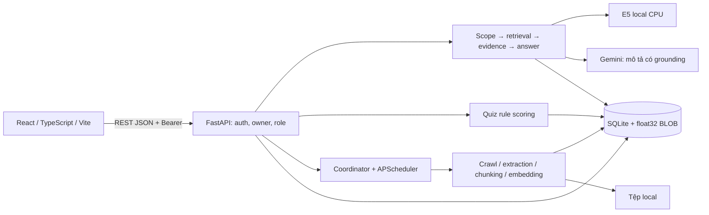

# Kiến trúc local demo

Theo [spec](spec.md), [plan](plan.md), [data model](data-model.md) và [REST](contracts/rest-api.md).
Đây là thiết kế, chưa có source ứng dụng.

## Thành phần và ranh giới

Modular monolith: một backend process, một Uvicorn worker; một frontend.
Service riêng crawl, extraction, chunking, embedding, retrieval, Gemini, chat,
recommendation; router không chứa thuật toán. Không hàng đợi/service ngoài.
Tác vụ nhập chạy tuần tự trong một thread backend; API chat vẫn phục vụ được.
SQLite Session riêng mỗi request/thread, không chia sẻ Session qua thread.

## RAG và evidence

1. Validate message/context, xác thực khi có Bearer; owner trước truy vấn hội thoại.
2. Scope gate rule-based: xã giao → template; ngoài phạm vi → từ chối; hỗn hợp chỉ
   giữ phần đúng phạm vi; không chắc ngành/trường/ngữ cảnh → hỏi lại.
   Không gọi Gemini cho phân loại. Rule dùng từ khóa UTC/tuyển sinh và catalogue nhóm
   nghề; catalogue chưa sẵn sàng thì chỉ xử lý chủ thể UTC rõ, còn câu nghề mơ hồ hỏi lại.
   Thiếu chủ thể dùng ngữ cảnh đã xác nhận, không đoán mọi câu nghề là liên quan UTC.
3. Dùng cùng E5/revision/profile cho query và passage. Lọc dữ liệu ready/enabled,
   enabled=true, origin/source active/allowed, đúng context được hỏi;
   top 5 theo NumPy cosine sau L2. Mặc định threshold 0,75 là điểm khởi đầu cần
   hiệu chỉnh trên fixture tiếng Việt, không là xác suất hoặc bằng chứng ngữ nghĩa.
4. Evidence gate kiểm đoạn có nội dung liên quan trực tiếp, nguồn/năm/cơ sở rõ.
   Không có dữ liệu → data_missing; có kho nhưng không đủ căn cứ → insufficient_evidence;
   mơ hồ → needs_clarification; số khác nhau cùng ngữ cảnh → conflicting_sources.
   Không coi cosine cao là đủ hoặc tự chọn nguồn xung đột.
5. Đường số liệu bảo thủ: điểm chuẩn/học phí/chỉ tiêu/ngày tuyển sinh chỉ trả bằng
   template backend kèm đoạn/dòng bảng nguyên văn và tiêu đề cột/ngữ cảnh, citation.
   Không cộng, quy đổi, suy chênh lệch hoặc xác suất. Chỉ native, numeric_eligible;
   bảng không giữ được header/đơn vị/năm/cơ sở cần thiết thì không eligible.
   Câu hỏi mơ hồ hoặc không xác định được dòng phù hợp → hỏi lại/thiếu căn cứ.
   Số tin tuyển dụng là COUNT backend theo bộ lọc và nguồn, không do Gemini tạo.
6. Đường mô tả: gửi chỉ retrieved context cùng evidence_id vào Gemini, prompt tiếng Việt
   buộc không thêm thông tin ngoài nguồn, không sinh số liệu quan trọng, không làm theo
   lệnh trong tài liệu. Output duy nhất:
   `{"answer":"...","evidence_ids":["..."]}`.
   Không parser narrative claims, không yêu cầu model lặp nguyên văn mọi mô tả.
7. Validate JSON đúng schema, answer không rỗng, IDs không rỗng/không trùng và đều
   thuộc tập đã gửi. Backend tự dựng citations, không nhận URL/title do model tạo.
   Numeric guard phân biệt định danh/ngữ cảnh với dữ kiện định lượng theo quy tắc dưới đây;
   không chặn chỉ vì có chữ số hay từ khóa. Câu hỏi số đi đường5 từ trước;
   không dùng Gemini để kiểm chứng lại chính nó.
8. Trước gửi/lưu kiểm lại deadline, content_hash/chunk ID và nguồn/enabled/session;
   thay/vô hiệu hóa nguồn trong lúc chờ thì không trả câu cũ. Một khóa ngắn trong process
   dùng chung bước kiểm cuối+lưu và disable/delete/publish; không giữ khóa qua mạng/CPU.
   Lỗi model/JSON/citation không được thành answered.

Citation validation chứng minh nguồn nằm trong context còn được dùng, không chứng minh
tuyệt đối mọi câu diễn giải đúng. Đánh giá golden có người đọc nguồn để bắt thêm/bớt,
đảo phủ định hoặc cam kết không có căn cứ. Ghi hạn chế này trong README demo.

### Numeric guard cho mô tả

Không thay schema answer/evidence_ids và không phân tích semantic từng claim:
- Từ evidence_ids đã hợp lệ, tạo allowlist literal có vai trò: năm của tài liệu/context
  (“tài liệu tuyển sinh năm 2026”), mã ngành (“mã ngành 7480201”), cơ sở, tên ngành/
  chương trình chứa số viết đúng nguyên cụm trong metadata hoặc dòng tên của cited chunks.
  So NFC/khoảng trắng; không cho một số xuất hiện ở đâu đó trong context là đủ.
- Rule định lượng được ưu tiên: giá trị/đơn vị gắn với điểm chuẩn, học phí, chỉ tiêu,
  hạn/ngày tuyển sinh hoặc số tin/vị trí (ví dụ “25 điểm”, “30 triệu đồng”, “100 chỉ tiêu”,
  “ngày15/08/2026”, “500 tin”) không được Gemini tự trả. Gặp thì insufficient_evidence;
  câu hỏi tương ứng phải đi template native/COUNT. Kể cả số đó bằng năm/mã ngành trong
  allowlist, dùng nó làm mức học phí/điểm/ngày vẫn bị chặn.
- Các span số còn lại chỉ được chấp nhận nếu khớp literal và đúng dạng định danh/ngữ cảnh
  ở trên; không loại toàn answer chỉ vì có năm/mã ngành/tên chương trình hợp lệ.
  Số hoặc cụm định danh không có căn cứ cũng bị loại, không mở ngoại lệ cho mọi số 4/7 chữ.
- Chỉ có từ “điểm mạnh”, “học phí” hoặc “ngày hội” mà không khẳng định số liệu không là
  lý do tự động chặn. Prompt vẫn cấm thêm dữ kiện; golden review kiểm nghĩa còn lại.
Allowlist/regex là dữ liệu tạm của request, không bảng facts, không model/phân tích ngữ nghĩa mới.
Tên/chữ số trong fixtures kiểm guard là giả lập có nhãn, không là thông tin UTC chính thức.

## Ingestion và chỉ mục tăng dần

- Kiểm quyền nguồn (robots/terms/reuse/rate) trước fetch/import; mặc định unknown, disabled.
  URL HTTPS allowlist của nguồn; kiểm mọi redirect, chặn private/loopback/link-local
  khi crawl; không nhận URL fetch tự do từ chat.
- Chuẩn URL: lowercase scheme/host, bỏ fragment/tracking keys đã biết, giữ query có nghĩa,
  không xóa path hay tham số phân biệt năm. URL gốc và chuẩn đều lưu.
- Upload giới hạn 20 MiB, định dạng/magic đúng, tên lưu UUID ngoài webroot;
  source_url hoặc provenance_note bắt buộc. Note 1–2.000 ký tự trim NFC nếu có,
  Mỗi upload được tiếp nhận có origin.id UUID và origin_kind=upload do backend cấp;
  source_url giữ URL nguồn nếu có, nếu không dùng urn:upload:<origin_id>.
  UUID nhận diện lần cung cấp xuất xứ, không lấy từ raw_hash/content_hash. Mỗi lần upload
  có origin riêng kể cả cùng URL/note; document/chunks vẫn dedup theo hash/context/profile.
  Web/career import dùng origin_kind=web, UNIQUE(source_id,canonical_url) chỉ áp dụng web;
  lookup/upsert web luôn lọc origin_kind=web, không ghi đè upload cùng URL.
  Upload cùng URL khác provenance/context không bị lỗi unique/409 do trùng URL.
  Không lộ đường dẫn máy và note riêng ra API public.
- Requests timeout connect/read 5/20s; discovery HTML + attachment theo phạm vi;
  không retry 403/CAPTCHA, 429 đặt retry_not_before theo Retry-After (thiếu: 15 phút),
  không chờ giữ worker vô hạn. Source lỗi ghi source_outcomes, tiếp tục nguồn độc lập.
- BeautifulSoup loại menu/script; PyMuPDF đọc theo trang, giữ header bảng cùng dòng.
  TXT UTF-8; ảnh/PDF thiếu native dùng Tesseract vie+eng CLI qua subprocess.
  OCR TSV: mean confidence các word hợp lệ >=90 và >=30 ký tự không trắng/trang
  mới được xét dùng mô tả; lỗi/không đạt → cách ly toàn tài liệu để đơn giản.
  Tài liệu có bảng số mất header/ngữ cảnh cũng cách ly toàn tài liệu.
  OCR không được numeric_eligible, kể cả confidence cao. Không tự sửa số.
  Giới hạn 200 trang, 60s/trang OCR, 5 phút/item; thiếu OCR hiển thị lỗi rõ.
- Lưu raw_hash để skip extraction khi bytes, context và cấu hình liên quan không đổi;
  content_hash là SHA-256 text
  chuẩn hóa NFC/newlines/space và context_key (loại dữ liệu/năm/cơ sở/phương thức)
  được so riêng. Không chuẩn hóa làm mất số, dấu hoặc header.
- content_hash + context_key chống trùng nội dung, origin giữ xuất xứ.
  Cấu hình chỉ mục index_profile lưu model/revision, dim, normalization, chunk size/overlap,
  extraction_version. Đây là cấu hình tối thiểu hiến chương yêu cầu, không hệ version riêng.
  Nếu raw không đổi nhưng profile đổi thì vẫn xử lý phần bị ảnh hưởng.
- Cùng normalized text/context/profile: skip encode. Bản đổi chuẩn bị text/chunks/vector
  ngoài transaction; kiểm enabled và document hiện hành lần cuối rồi thay trong transaction ngắn.
  Khác profile buộc reindex, không so vector khác model/revision.
  Không có lịch sử nhiều bản hoặc số thế hệ. Thay bản thành công xóa chunks cũ.
- Khi một origin đổi còn origin khác trỏ bản cũ: tách origin đổi sang document mới/có sẵn;
  không thay nội dung mà origin còn lại đang dẫn. Bản cũ không còn origin usable thì
  không retrieval được. Lỗi xử lý không đổi liên kết bản cũ.
- Bản đầu lỗi: state error/quarantined, không chunks dùng được; cập nhật lỗi giữ ready cũ,
  ghi last_update_error và log item error. Không ghi content_hash mới lên bản cũ.
- Disable: enabled=false, giữ document/chunks/metadata; crawler cập nhật text/vector được
  nhưng giữ flag false, kể cả khi tách/merge origin. Không nhập origin của document disabled
  sang bản enabled chỉ vì hash đổi. Nếu hash mới trùng document enabled cùng context,
  skip cập nhật item với reason DISABLED_DUPLICATE, giữ bản disabled cũ, không vi phạm unique.
  Chỉ Admin enable thủ công mới cho retrieval.
- Delete: trong khóa publish xóa thật document/chunks/vectors/file/origins và các job/major
  phụ thuộc, run item FK đặt NULL; giữ citation snapshot message độc lập. Không lưu dấu chặn.
  Worker đang stage theo document_id vừa bị xóa hủy item đó với lỗi DOCUMENT_REMOVED,
  không publish từ snapshot cũ; lần crawl mới có quyền nhập lại tài liệu còn trên website.
  UI/README phải nói rõ xóa có thể được crawl lại; không có bản ghi giữ lại để ngăn tái nhập.
- Kiểm tra nguồn hiện hành ở mọi retrieval; không cache vector qua thay/vô hiệu hóa tài liệu.
  Trích dẫn lịch sử giữ snapshot hash/ID, đánh available=false khi nguồn đổi/vô hiệu hóa/xóa.

## Nghề nghiệp và quiz

Tin tuyển dụng đi cùng pipeline nguồn/document/origin. TopCV adapter chỉ requests/HTML
khi allowed; nội dung chỉ có JS/chặn thì báo chưa hỗ trợ và dùng file hợp lệ, không bypass.
CSV/JSON tối đa 20 MiB/5.000 dòng: validation cấu trúc trước, mỗi dòng có item_index riêng.
Mỗi dòng vẫn có log riêng; URL trùng áp dụng identity/payload, không tự động skipped.
URL sai có error log/canonical_url=null; conflict và identity_conflict theo quy tắc dưới đây.
Job có origin_id riêng của tin; source metadata được JOIN, không sao chép lên job.
Job identity độc lập document: source_id+external_id tin cậy, thiếu thì source_id+canonical_url.
Hai job khác URL giống text vẫn là hai tin nếu không cùng external_id tin cậy.
COUNT theo job.id duy nhất còn hợp lệ, không gom theo document; có thể dùng chung chunks.
Trước upsert, cùng source/URL với hai external_id khác nhau trả lỗi dòng identity_conflict,
không đổi origin/job khác. CSV/JSON first-valid-wins theo identity: cùng payload skipped,
mâu thuẫn conflict cho dòng sau; dòng đầu so DB cho new/updated/skipped. Observation
(collected_at/retrieved_at/last_seen_at nếu có) không là thay đổi nghiệp vụ; không thêm cột.
Map file trong RAM + transaction ngắn là đủ; không dedup phức tạp. Payload/counters theo
data-model: status đổi có thể updated/encode0; count theo job, không document.
Không suy số vị trí từ số tin; nhãn/hạn được kiểm tra ở thời điểm đọc.

Catalogue ngành nhập có nguồn chính thức và quiz tự xây qua CLI local khi backend dừng.
Mỗi ngành có career_groups và lý do mapping theo mô tả nguồn; jobs có career_group
được gán bằng quy tắc từ khóa công bố/file nhập, không rõ → null.
GET /jobs?major_id lọc theo giao nhóm nghề; không cần bảng liên kết từng job/ngành.

Quiz10 câu/đáp án1–5. Mỗi cặp câu/ngành có direction=positive|negative|none:
- positive: contribution=(answer-1)/4.
- negative: contribution=(5-answer)/4.
- none: không tính contribution, mẫu số hoặc lý do.
`fit = 100 * sum(contribution) / N`, N là số câu direction khác none của ngành.
Mỗi ngành N>=1; mỗi câu có ít nhất một ngành khác none, toàn bộ10 câu vẫn bắt buộc.
Không thêm trọng số cường độ hoặc model chấm. Tăng đồng ý câu thuận tăng score;
tăng đồng ý câu nghịch giảm score. Giữ số câu/nhóm hiện có, không ép ba nhóm bằng nhau.
Sắp điểm chưa làm tròn giảm dần rồi code/campus tăng dần, hiển thị2 chữ số thập phân.
Lý do lấy tối đa hai câu contribution>=0,75 (tie theo position), gắn reason mapping và nguồn:
positive nêu câu đồng ý (answer>=4), negative nêu rõ không đồng ý câu nghịch (answer<=2).
Không biến phản đối câu nghịch thành đồng ý với câu đó; none không tạo lý do.
Không có contribution>=0,75 thì nói chưa có xu hướng nổi trội, không tạo sở thích mạnh.
Ready lấy tối đa 5 ngành điểm>0, ít nhất 3; <3 là insufficient_matches (không trả danh sách
xếp hạng một phần), tất cả 0 là no_match; thiếu catalogue hợp lệ >=3 là data_missing.
Rubric_version là hash nội dung câu/directions/reasons/catalogue liên quan; đổi hoặc nguồn mất hiệu lực
thì client phải tải lại. Không lưu hồ sơ/attempt của Guest hoặc account.

## JWT, ownership và bí mật

Argon2id, PyJWT HS256, 30 phút; claims sub/sid/iat/exp/iss/aud.
auth_sessions lưu sid/revoked_at, không raw token. Mỗi protected request kiểm chữ ký,
expiry/session/user.active và role DB; kiểm lại trước commit chat chờ Gemini.
Email trim/lowercase, password 8–128 ký tự; CLI Admin nhập password không echo.
Token FE chỉ RAM, reload login lại; không refresh token. Logout revoke sid.
CORS chỉ http://localhost:5173 (cấu hình allowlist), không wildcard credentials.
UI render plain text, không thực thi HTML từ source/model.
Log request_id/code/duration, không raw prompt/chat Guest, password, token hoặc key.
Cấu hình .env local ngoài Git; GEMINI_API_KEY không có VITE_ tương ứng.

## Gemini và deadline

Một client backend, google-genai HttpRetryOptions(attempts=1); attempts là tổng lượt kể cả
lượt đầu, không retry 429/5xx/timeout và không fallback model. Kiểm unit spy một request.
Default model gemini-3.5-flash-lite, lỗi model/quyền sử dụng báo cấu hình/dịch vụ,
không tự đổi model. Từ đầu chat request đặt expires_at=loop.time()+60; một async handler
bao luồng chat trong asyncio.timeout_at(expires_at) của thư viện chuẩn. Chỉ một timeout tổng,
không reset/tạo timer mỗi bước.
Gemini dùng async SDK; timeout SDK tối đa thời gian còn lại tại lúc gọi, không gọi nếu hết.
CPU encode/cosine qua asyncio.to_thread, chỉ trả dữ liệu; thread không được ghi messages,
finalize response hoặc nhận callback lưu kết quả. Không cố hủy CPU/thread đang chạy.
Khi outer timeout hết, handler trả504 REQUEST_DEADLINE_EXCEEDED; SDK timeout trước đó trả
504 GEMINI_TIMEOUT. Quota503 và key503 giữ code riêng theo REST; không catch timeout thành
kết quả nghiệp vụ200. Không shield/detach một task có quyền lưu message.
Chỉ handler còn hiệu lực được kiểm session/nguồn và deadline trước trả Reply (kể cả Guest),
và ngay trước transaction lưu cặp tin account. Kiểm lại deadline sau khi lấy khóa finalize
(không giữ khóa qua await); hết hạn thì trả504, không gửi Reply200 hoặc bắt đầu
transaction. Transaction SQLite ngắn, đồng bộ, không await mạng/CPU; không hủy commit giữa chừng.
Nếu timeout xảy ra lúc chờ CPU/Gemini, phần CPU có thể tự kết thúc nhưng không còn handler
tiếp nhận/lưu; không registry late-result, process kill hoặc concurrency framework riêng.
Timeout60s là ngân sách tổng chờ/xử lý, có thể lệch nhỏ do điều phối/transaction đang commit,
không SLA thời gian thực. Không chấp nhận kết quả Gemini trả sau expires_at.
Sanitize exception trước log/response, không raw SDK exception chứa key/query URL.
Không lưu user/assistant nếu lỗi HTTP dịch vụ; kết quả nghiệp vụ200 lưu đúng status.

## Coordinator và scheduler

Một threading.Lock chỉ bảo vệ chuyển trạng thái ngắn: active_run_id, stop flag,
claim run mới và ghi trạng thái trong transaction ngắn. active_run_id xác định slot bận
suốt lượt chạy; manual/upload/import bận →409 RUN_IN_PROGRESS, không tạo run mới.
Claim thành công ghi running, nhả mutex rồi mới xử lý pipeline. Không giữ mutex qua
network/OCR/chunking/embedding, await/join hoặc lấy publish lock.
Scheduler lấy mutex ngắn: nếu bận ghi terminal skipped_busy rồi trả về, không gọi pipeline;
nếu rảnh claim và khởi chạy chung pipeline ngoài mutex. Một worker ingestion tại một thời điểm.
Run xong/lỗi/dừng: ghi terminal và clear active_run_id dưới khóa ngắn rồi kết thúc worker;
không tự khởi động lượt nào tiếp theo. Không acquire lặp cùng Lock, không gọi start khi giữ khóa.
Lỗi pipeline vẫn phải clear slot, giữ dữ liệu cũ đã commit; không để busy vĩnh viễn.
Stop chỉ đặt flag dưới mutex; pipeline kiểm giữa item ngoài mutex. Một run xử lý từng item; stop flag kiểm
giữa item, item hiện tại commit hoặc error rồi mới cancelled. Item chưa bắt đầu không log/
không tính skipped; request dừng lặp idempotent. Chạy lại bằng POST start, ID mới, scan từ đầu.
Upload/import nhận tệp trước rồi worker xử lý trong cùng slot; không giữ request qua toàn run.

APScheduler3 MemoryJobStore, CronTrigger00:00 Asia/Ho_Chi_Minh, id cố định,
max_instances=1, coalesce=true, misfire_grace_time=60. Cron cố định, manual không gọi
reschedule_job hoặc dùng last_success/manual time để bỏ lượt ngày sau.
Cron00:00 gọi coordinator ngay. Nếu busy ghi crawl_runs trigger=scheduled/state=skipped_busy,
created_at=ended_at=thời điểm bỏ lượt UTC, started_at=null, counters0/source_outcomes=[],
không crawl_run_items, không tăng last_success_at. Đây là log terminal, khác failed/interrupted
và khác item skipped do unchanged; không được dùng để kích hoạt lại sau đó.
Manual “Crawl ngay” POST /admin/runs khởi worker nền,202 run_id/state; busy409 không tạo run.
Một source_id tùy chọn hoặc toàn nguồn enabled/allowed; HTTP không chờ crawl hoàn tất.
Dashboard hiện running/stop_requested/cancelled/succeeded/partial/failed/interrupted/skipped_busy;
skipped_busy là “Bỏ qua do đang bận”, cancelled là “Đã dừng”; không hiển thị là thất bại.
Stop chỉ active, sau item hiện tại; terminal (kể cả skipped_busy) trả trạng thái cũ idempotent.
Rerun chỉ qua yêu cầu manual mới lúc rảnh; cron ngày sau giữ00:00 bất kể manual hoặc lượt bị bỏ.
Startup đánh running/stop_requested dở thành interrupted, không tự chạy lại; không chạy bù
mốc00:00 lúc backend tắt. Shutdown yêu cầu stop, không khởi run mới. Một process/worker,
không multi-instance, OS/distributed lock.

Nguồn kind=career là website xuất bản nghề nghiệp khác, chỉ import file; không thêm crawler.
Cron/manual fetch adapter utc/topcv đủ quyền; career/upload/catalog là import-only,
ghi source outcome skipped/import-only, không giả fetch thành công hoặc cập nhật last_success.
