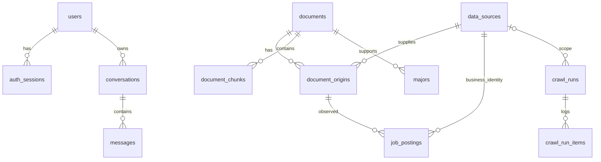

# Mô hình dữ liệu và ERD

SQLite/SQLAlchemy, UUID TEXT, timestamp UTC RFC3339. NULL là chưa biết, không là0.
foreign_keys=ON, WAL, busy_timeout=5000. JSON lưu TEXT và validate bằng Pydantic.
Không tự reset DB khi startup; init_db tạo bảng còn thiếu.

## ERD

quiz_questions.scoring_json tham chiếu major ID qua validation import; không thêm bảng
join cho bộ 10 câu. messages giữ citation snapshots, không FK cascade làm mất lịch sử.
13 bảng: users, auth_sessions, conversations, messages, data_sources, documents,
document_origins, document_chunks, majors, quiz_questions, job_postings,
crawl_runs, crawl_run_items.

## Schema và ràng buộc

| Bảng | Trường ngoài id | Ràng buộc/quan hệ |
| --- | --- | --- |
| users | email_normalized, password_hash, role, active, created_at | UNIQUE email; role USER/ADMIN; không plaintext password |
| auth_sessions | user_id, expires_at, revoked_at, created_at | FK users; id là sid; không raw JWT |
| conversations | user_id, title, next_seq, created_at, updated_at | FK users; title trim1..100 |
| messages | conversation_id, seq, turn_id, sender, content, reply_status, citations_json, created_at | FK conversation ON DELETE CASCADE; UNIQUE(conversation_id,seq); sender user/assistant; cặp turn_id có hai tin |
| data_sources | name, kind, base_url, allowed_paths_json, enabled, permission_status, robots_url, terms_url, reuse_basis, checked_at, min_interval_seconds, retry_not_before, last_success_at | kind utc/topcv/career/upload/catalog; permission unknown/allowed/denied; enabled cần allowed và reuse_basis/checked_at; khoảng cách request tối thiểu2s hoặc lớn hơn theo nguồn |
| documents | title, provenance_note, content_text, raw_hash, content_hash, context_key, year, campus, major_code, method, index_profile, state, enabled, created_at, updated_at, last_checked_at, last_update_error, quality_reason | state pending/ready/quarantined/error; hash nullable khi chưa extract; UNIQUE(content_hash,context_key) WHERE content_hash IS NOT NULL |
| document_origins | document_id, source_id, origin_kind, canonical_url, original_url, provenance_note, publisher, published_at, retrieved_at, active | id UUID độc lập hash; origin_kind NOT NULL web/upload; FK document ON DELETE CASCADE; FK source ON DELETE RESTRICT; UNIQUE(source_id,canonical_url) WHERE origin_kind='web'; upload URL không unique, URN theo origin_id |
| document_chunks | document_id, ordinal, text, chunk_hash, embedding, embedding_dim, extraction_kind, numeric_eligible, source_snapshot_json, year, campus, major_code, method, page, section | FK docs ON DELETE CASCADE; UNIQUE(document_id,ordinal); dim384, BLOB length1536, finite/L2 application validate; page>=1 hoặc null; extraction_kind native/ocr; OCR numeric_eligible=false |
| majors | code, name, campus, description, source_document_id, source_content_hash, source_page, career_groups_json, active | UNIQUE(code,campus); FK docs ON DELETE CASCADE; source_content_hash phải khớp bản hiện hành khi phục vụ |
| quiz_questions | position, text, scoring_json, active | position1..10, UNIQUE position cho active; scoring keyed major UUID, entry {direction:positive/negative/none,reason:string}; không trọng số cường độ |
| job_postings | source_id, identity_key, origin_id, external_id, title, employer, description, posted_at, deadline_at, observed_status, career_group, classification_reason, updated_at | FK origin NOT NULL ON DELETE CASCADE; FK source NOT NULL; UNIQUE(source_id,identity_key); external_id nullable; observed_status open/closed/unknown; group nullable |
| crawl_runs | source_id, trigger, created_at, triggered_by, state, started_at, ended_at, stop_requested_at, stop_requested_by, new_count, updated_count, skipped_count, error_count, source_outcomes_json | source_id nullable (mọi nguồn); trigger scheduled/manual/upload/job_import; state running/stop_requested/cancelled/succeeded/partial/failed/interrupted/skipped_busy; started_at nullable chỉ cho skipped_busy |
| crawl_run_items | run_id, item_index, source_id, canonical_url, document_id, outcome, reason, started_at, ended_at | FK run; document_id ON DELETE SET NULL; UNIQUE(run_id,item_index), item_index>=1; source/URL/doc nullable; outcome new/updated/skipped/error |

Chỉ mục phụ: origins(document_id), origins(source_id,canonical_url) không unique cho tra cứu chung,
chunks(document_id), messages(conversation_id,seq),
jobs(deadline_at,career_group), runs(started_at). Không cần index vector ngoài SQLite.

## Metadata, nguồn và xuất xứ

- context_key = serialize ổn định loại dữ liệu/year/campus/major_code/method; giá trị
  chưa biết dùng marker rõ, không gộp unknown với giá trị đã biết. Ngữ cảnh khác không
  dedup cùng nội dung. Không suy metadata từ ngày thu thập/ngày đăng.
- raw_hash SHA256 bytes; content_hash SHA256 normalized text; context_key so riêng.
  index_profile là JSON cấu hình đã dùng: model/revision/384/L2/chunk320/overlap48/
  extraction_version. Cùng text/context/profile không encode lại; đổi profile reindex.
- provenance_note trên document giữ ghi chú xuất xứ upload đầu tiên (nếu có);
  mỗi origin lưu note riêng của lần cung cấp nguồn. Note nullable khi có URL HTTPS nguồn
  đủ xuất xứ, nếu có thì NFC/trim1..2000; không URL thì bắt buộc note.
  URN không thay note. Upload mới luôn có origin UUID mới, giữ note riêng, không ghi đè
  origin/note cũ hoặc trả409 chỉ vì cùng bytes/URL mà khác note hợp lệ.
  GET Admin trả note trên document và toàn bộ origins, restart không mất; public không lộ note riêng.
- source_snapshot_json trên chunk lưu origin_id, URL/URN, title, source_name, year,
  campus, major_code, method, page/section. Metadata công khai được dựng từ origin
  hiện còn usable; snapshot giữ để theo dõi bản được trích, không bỏ qua kiểm quyền nguồn.
- Citation snapshot message gồm document_id/chunk_id/content_hash/title/url/source_name/
  year/campus/page/section. available được tính khi đọc: doc/chunk/hash/nguồn còn usable.
  Chunk bị thay không cascade xóa message; lịch sử không là evidence mới.

### Identity origin độc lập fingerprint (H1)

- origin.id là UUID backend cấp, không suy từ raw_hash/content_hash.
  origin_kind=upload cho POST upload, kể cả có source_url; mỗi request upload được tiếp nhận
  ghi một lần cung cấp xuất xứ riêng. Nếu không có source_url, original/canonical_url dùng
  urn:upload:<origin_id>; có URL thì giữ URL nguồn/chuẩn hóa, không dùng URL làm khóa upload.
- origin_kind=web cho crawler và origin URL từng job CSV/JSON. Chỉ các origin này có
  partial UNIQUE(source_id,canonical_url); URL giống nhau ở origin upload vẫn hợp lệ.
  Lookup/upsert crawler/job phải lọc origin_kind=web; không chọn origin upload cùng URL.
  Upload không tìm/ghi đè origin bằng hash hoặc URL. Không đặt UNIQUE raw_hash/canonical_url chung mọi origin.
- Document dedup vẫn UNIQUE(content_hash,context_key) cho bản chưa xóa. Upload cùng text/
  context/profile dùng document/chunks cũ, encode0; nhiều origins là nhiều lần cung cấp
  nguồn, không phải nhiều document trùng. Cùng bytes nhưng context khác có document riêng.
- Receipt upload202 trả origin_id để Admin theo dõi; pending origin gắn document pending,
  sau xử lý có thể trỏ document dedup hiện hữu. Giữ nguyên origin_id khi merge; file lỗi
  vẫn có metadata/lý do theo run, không thành ready.

## Trạng thái tài liệu và số liệu

- pending → ready nếu extraction/chunk/embed thành công; lỗi → error;
  chất lượng không đạt → quarantined (quality_reason bắt buộc). Không có chunks RAG
  của tài liệu error/quarantined. enabled=false không usable; trạng thái xử lý không trùng với flag enabled.
- Native HTML/PDF rõ tự index, numeric_eligible=true chỉ cho đoạn/dòng bảng giữ rõ
  header/đơn vị/context. Đoạn mô tả không số có thể false. Nếu bảng số không tin cậy,
  cách ly tài liệu, không đưa đoạn mơ hồ vào RAG.
- OCR đạt gate chỉ dùng mô tả, numeric_eligible=false; failed/low quality cách ly.
  Gate không là chứng nhận nội dung đúng. Không có trạng thái Admin duyệt từng trang/số.
- Năm/mã ngành/cơ sở/tên chương trình có số là literal định danh/ngữ cảnh khi khớp
  metadata hoặc dòng tên của cited chunks; không vì có số mà chuyển thành dữ kiện định lượng.
  Numeric guard chỉ có allowlist/rules tạm theo request (architecture), không thêm bảng.
- Index ready nghĩa là đọc/index được, không tự chứng minh số liệu đúng ngữ cảnh.
  Evidence service vẫn kiểm ngữ cảnh khi trả lời; nguồn xung đột phải báo xung đột.
- Cập nhật thất bại: giữ state/text/hash/chunks bản cũ, ghi last_update_error;
  chất lượng bản thử mới hiện trong run item reason. Dashboard phân biệt “đang dùng bản tốt”
  và “cập nhật mới lỗi/cách ly”, không đánh bản cũ thành lỗi.

## Publish, duplicate và quản lý tài liệu

1. Kiểm URL/quyền rồi hash/context/profile; unchanged skip encode.
2. Stage extraction/chunks/vectors ngoài transaction, giữ bản tốt nếu lỗi.
3. Publish transaction ngắn dưới khóa: kiểm document còn tồn tại, quyền và flag enabled.
   Crawl cập nhật document disabled vẫn giữ enabled=false. Tách origin đổi sang document
   mới phải mang flag false; merge không được chuyển origin disabled sang document enabled.
   Nếu hash mới của disabled trùng document enabled cùng context: skip update với reason
   DISABLED_DUPLICATE, giữ bản disabled cũ. Nếu đụng doc dedup disabled thì tái sử dụng
   nhưng không bật; Admin quyết định enable.
4. Disable chỉ enabled=false. Enable giữ state xử lý, chỉ ready có chunks hợp lệ được RAG;
   không có chunks thì phải xử lý lại qua upload/crawl. Không cần state disabled riêng.
5. Delete xóa vật lý doc/file/chunks/origins, jobs/majors phụ thuộc cascade;
   crawl_run_items.document_id SET NULL; messages giữ citation snapshot available=false.
   Quiz JSON tham chiếu major đã xóa thì data_missing, không lỗi server; nhập lại catalogue
   hợp lệ để khôi phục rubric. Không lưu dấu chặn. Nguồn còn tài liệu thì crawl sau nhập lại.
   Item đang stage bị mất document đích phải error DOCUMENT_REMOVED, không tự tạo lại
   trong chính item cũ. Lượt crawl mới xử lý như tài liệu mới.

## Job và mapping ngành

- Mỗi job tham chiếu đúng origin tin, không origin tệp CSV/JSON chung.
  Origin giữ URL gốc của tin, source_id giữ tên nguồn, retrieved_at chính là collected_at
  được khai báo/kiểm tra. Thời gian import nằm run, không thay collected_at.
- GET /jobs JOIN job → origin → source và document để xuất origin_id/source_url/
  source_name/collected_at/document_id. Không lưu thêm bốn trường nguồn lên job.
- Job identity_key = ext:<external_id> nếu ID nguồn ổn định/tin cậy, nếu không url:<canonical_url>.
  UNIQUE(source_id,identity_key). source_id trên job phục vụ khóa nghiệp vụ, phải khớp
  origin.source_id (service validate); không sao chép source_name/URL/timestamp lên job.
  Cùng external_id tin cậy đổi URL: upsert cùng job, cập nhật origin hiện hành;
  không có ID và URL khác: job riêng dù cùng content/document. Nếu record thiếu ID nhưng
  cùng URL với job đã có ID thì dùng job đó, không tạo bản sao hoặc hạ ext-key. Khi bổ sung
  ID cho job url-key thì nâng sang ext-key nếu không xung đột; nếu xung đột báo lỗi dòng.
  Trước mọi upsert origin/job, JOIN theo source_id+canonical_url: hai external_id không rỗng
  khác nhau →error/reason identity_conflict, không đổi bất kỳ job/origin liên quan.
  Kiểm cả DB và các dòng đã nhận trong file; không dùng URL để ghi đè job khác.
  external_id chỉ dùng ext-key khi adapter/quy tắc nguồn xác định tin cậy; không gộp bằng text.
- COUNT theo job.id, JOIN origin/doc/source usable và status/time hợp lệ; không DISTINCT
  document_id. Hai job có thể cùng document/chunks mà vẫn count2.
- CSV/JSON chọn source_id của website xuất bản thực cho từng dòng; optional default source_id
  ở request chỉ áp dụng khi thiếu trường dòng. Nguồn có sẵn allowed/reuse_basis/checked_at,
  URL trong allowlist; file không thay nguồn xuất bản và không hợp thức hóa thu thập trái phép.
- observed_status=open và deadline chưa qua mới là open; closed hoặc quá hạn là expired;
  thiếu hạn/tình trạng là unverified. Deadline chỉ ngày chuyển cuối ngày VN, so UTC khi đọc.
- majors.career_groups_json = [{code,label,reason}], reason dựa description/nguồn ngành.
  job.career_group từ file/quy tắc từ khóa công bố, classification_reason lưu lý do.
  Null thì không xuất hiện trong filter ngành. Không cần bảng quan hệ từng cặp.
- Catalogue chỉ dùng khi source_document ready/allowed và source_content_hash khớp;
  nguồn thay đổi cần nhập lại catalogue từ bản mới, không phục vụ mapping cũ.

## Run và log từng item

active_run_id giữ quyền chạy trong RAM; threading.Lock chỉ bảo vệ chuyển trạng thái ngắn,
không giữ qua network/OCR/embedding. Claim run mới dưới khóa, nhả trước pipeline;
kết thúc clear active_run_id rồi kết thúc worker. Không acquire lặp Lock. Cron busy ghi
terminal skipped_busy, không xử lý sau đó. Không có unique URL trên crawl_run_items.
item_index là thứ tự toàn run; với một file CSV là record logic sau header từ1,
JSON là vị trí phần tử từ1. Với crawl là thứ tự item discovery từ1 (dedup trước fetch).
URL sai → canonical_url=null/outcome=error. URL lặp không tự quyết định outcome:
áp dụng job identity, so payload và first-valid-wins dưới đây; log từng dòng độc lập.

new+updated+skipped+error = số item đã xét; mỗi item đúng một outcome sau xử lý.
Nguồn discovery lỗi nằm source_outcomes riêng, không tạo item giả. Run:
- succeeded: không lỗi item/nguồn, kể cả chỉ skip.
- partial: có lỗi và có item thành công/skip; failed: chỉ lỗi, không kết quả dùng được.
- cancelled: dừng chủ động giữa item, lưu actor/time; không tính item chưa bắt đầu.
- interrupted: run dở khi app khởi động lại với cấu hình một process.
last_success_at chỉ cập nhật nguồn hoàn tất không lỗi, không cập nhật khi stop/lỗi nguồn.
Rerun tạo run mới, không resume offset hoặc rollback toàn run.

### Import CSV/JSON: identity, payload và outcomes (U1/U2)

Xử lý theo thứ tự record logic trong file. Normalize NFC/whitespace, URL theo quy tắc hiện có,
datetime về UTC; optional thiếu dùng null, observed_status thiếu dùng unknown (record là snapshot,
không PATCH). Payload nghiệp vụ gồm canonical_url, external_id sau đối chiếu identity,
title/employer/description/posted_at/deadline_at/observed_status/career_group/classification_reason.
Row thiếu ID khớp job ext-key hiện hữu thì giữ ID/key cũ trước so payload, không xóa ID.
Không so content_hash/document_id để quyết định job mới hay thay đổi.
collected_at/origin.retrieved_at, thời gian import và last_seen_at (nếu có) là observation,
không nằm payload. Không cần thêm cột last_seen_at. updated_at chỉ đổi khi tạo/đổi nghiệp vụ.
Trạng thái expired do đồng hồ vượt deadline không tự làm payload đổi; observed_status nguồn đổi thì có.

1. Validate dữ liệu/quyền và kiểm URL/external_id trước mọi ghi job/origin: cùng source+URL
   với hai ID không rỗng khác nhau →error/identity_conflict (ưu tiên hơn conflict payload).
   Đổi URL cùng ext-key chỉ được khi URL đích không thuộc identity khác.
2. Map tạm trong RAM cho file, keyed identity đã resolve. Chỉ dòng hợp lệ ghi thành công
   đầu tiên chiếm identity; dòng lỗi không chiếm chỗ. Dòng sau cùng identity/payload
   →skipped, khác payload →error/conflict, không thay DB/provenance từ dòng đầu.
   Chỉ nâng url-key sang ext-key khi dòng hợp lệ đầu tiên được áp dụng so DB; cập nhật map
   để vẫn nhận ra cùng job. Dòng sau mâu thuẫn không được nâng key hoặc ghi observation.
3. Dòng hợp lệ đầu tiên so DB: identity chưa có →new (inserted); đã có và payload bằng nhau
   →skipped; payload nghiệp vụ hoặc observed_status khác →updated.
   Dòng skipped đầu tiên có thể cập nhật observation hợp lệ từ cùng nguồn, không đổi
   updated_at/nguồn gốc và không encode lại text không đổi; dòng lặp trong file không ghi.
4. Một transaction ngắn commit job+origin/document liên quan sau validation; lỗi identity/
   payload không ghi đè origin của job khác, không rollback dòng hợp lệ đã commit trước.
   UNIQUE(source_id,identity_key) và web origin unique giữ như cũ; không thêm bảng dedup.
5. Với trigger job_import, counters đếm job-row outcomes, không document hoặc số lần encode:
   new/updated/skipped/error loại trừ nhau và tổng bằng số record xét. Hai job cùng document
   vẫn có thể new2; đổi status nhưng text giữ nguyên vẫn updated và encode0.
   Với crawl/upload, counters vẫn theo document item như thiết kế hiện tại.

## Quiz và quyền sở hữu

Bộ active đúng10 câu; option1..5 theo contract. scoring_json mapping mỗi major ID
đến {direction:positive|negative|none,reason:string}; thiếu mapping được coi lỗi rubric,
không tự hiểu là none. Mỗi ngành N>=1 câu khác none, mỗi câu có ít nhất1 ngành khác none.
Contribution positive=(a-1)/4, negative=(5-a)/4, none không tính; fit=100*sum(contribution)/N.
Chỉ lưu direction/reason, không thêm trường trọng số song song. Reason giải thích đúng chiều thuận/nghịch.
Rubric_version tính hash câu/directions/reasons/catalogue source hashes; đổi direction
đổi version, client rubric cũ409. Không lưu attempt.
Scoring chi tiết ở architecture; API từ chối rubric cũ/answers sai, không nhận đầu vào khác schema.
Owner filter conversations/messages áp dụng cả ADMIN. Message pair commit nguyên tử sau
kiểm lại session/nguồn và deadline của handler trước transaction; thread CPU không ghi messages,
không nhận callback lưu. Status nghiệp vụ giữ đúng, HTTP lỗi/timeout không tạo answered.

## Log skipped_busy và cron cố định

Cron busy ghi trigger=scheduled/state=skipped_busy, created_at=ended_at=thời điểm bỏ lượt,
started_at=null, mọi counter0/source_outcomes=[]; không items. Run đã kết thúc, không phải
crawl failed hoặc skipped item. Không tăng last_success_at, không kích hoạt lại lúc rảnh/
restart. Manual busy409 không tạo run. Lượt chạy thật có started_at; failed chỉ khi đã thử
crawl và lỗi theo quy tắc trên. Không lưu mốc chờ hoặc thêm bảng; cron ngày sau vẫn00:00.
